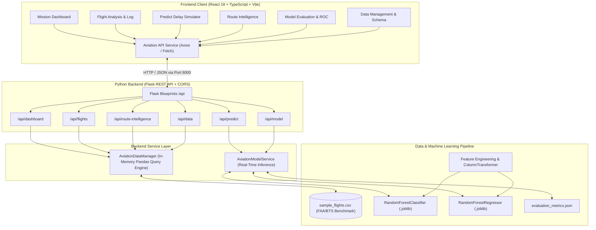

# System Architecture & Technical Specifications



## API Specifications

### 1. `GET /api/health`
Returns service status, model availability, and active dataset row counts.
- **Response**:
```json
{
  "status": "healthy",
  "service": "AI-Powered Aviation Intelligence Platform",
  "version": "1.0.0-alpha",
  "model_ready": true,
  "records_loaded": 1250,
  "environment": "development"
}
```

### 2. `GET /api/dashboard/summary`
Returns high-level fleet statistics, delay causes breakdown, carrier punctuality ranking, hourly delay curves, and recent critical disruptions.

### 3. `GET /api/flights`
Query parameters:
- `q`: Search term (flight ID, carrier name, origin, dest)
- `carrier`: Filter by airline code (DL, UA, AA, WN, B6, AS)
- `risk_tier`: Filter by Low, Moderate, High, Severe
- `status`: ontime or delayed
- `page`: Page index (1-based)
- `limit`: Records per page (default: 15)

### 4. `POST /api/predict/flight`
Executes real-time inference using the Scikit-Learn baseline pipeline.
- **Request Body**:
```json
{
  "carrier_code": "DL",
  "origin": "ATL",
  "dest": "LAX",
  "dep_hour": 17,
  "dep_minute": 30,
  "day_of_week": 4,
  "month": 7,
  "origin_weather": "Thunderstorm",
  "dest_weather": "Clear",
  "wind_speed_knots": 28.0,
  "visibility_miles": 4.5,
  "precipitation_mm": 12.0,
  "congestion_level": "High",
  "taxi_out_minutes": 32.0
}
```
- **Response**:
```json
{
  "success": true,
  "data": {
    "prediction": {
      "delay_probability": 0.742,
      "delay_probability_pct": 74.2,
      "is_delayed_predicted": true,
      "expected_delay_minutes": 38.5,
      "risk_tier": "Severe Risk",
      "risk_color": "#ef4444",
      "confidence_score": 0.76,
      "model_version": "1.0.0-baseline"
    },
    "contributing_factors": [
      {
        "factor": "Adverse Origin Weather (Thunderstorm)",
        "impact": "High Negative Impact",
        "score": 32,
        "description": "Terminal airspace experiencing thunderstorm, inducing ground delay programs (GDP)."
      }
    ],
    "operational_recommendations": [
      "Alert flight dispatch and gate operations for possible ground delay program (GDP) impact.",
      "Pre-calculate fuel diversion reserves if destination weather holds below minimums."
    ]
  }
}
```

### 5. `GET /api/route-intelligence`
Aggregates performance metrics across origin-destination corridors and airport hubs.

### 6. `GET /api/model/evaluation`
Provides honest Scikit-Learn performance metrics, confusion matrix counts, ROC/PR curve points, and feature importance rankings.

### 7. `POST /api/data/regenerate`
Regenerates the benchmark CSV dataset and reloads the memory cache.
