# System Architecture & Technical Specifications

```mermaid
flowchart TD
    subgraph Frontend["Frontend Client (React 18 + TypeScript + Vite)"]
        UI_Dash["Mission Dashboard"]
        UI_Analysis["Flight Analysis & Log"]
        UI_Predict["Predict Delay Simulator (Model Selector)"]
        UI_Route["Route Intelligence & Corridors"]
        UI_Model["Model Comparison & Evaluation (Baseline vs Candidate)"]
        UI_Data["Data Management (CSV Upload & Quality Audits)"]
        API_Client["Typed Aviation API Client"]
        
        UI_Dash --> API_Client
        UI_Analysis --> API_Client
        UI_Predict --> API_Client
        UI_Route --> API_Client
        UI_Model --> API_Client
        UI_Data --> API_Client
    end

    subgraph Backend["Python Backend (Flask REST API + CORS)"]
        Router["Flask Blueprints /api"]
        DashBP["/api/dashboard"]
        FlightBP["/api/flights"]
        PredictBP["/api/predict"]
        RouteBP["/api/route-intelligence"]
        ModelBP["/api/model"]
        DataBP["/api/data"]
        AnalyticsBP["/api/analytics"]

        Router --> DashBP
        Router --> FlightBP
        Router --> PredictBP
        Router --> RouteBP
        Router --> ModelBP
        Router --> DataBP
        Router --> AnalyticsBP
    end

    subgraph CoreServices["Processing & ML Service Layer"]
        IngestionPipeline["FlightDataIngestionPipeline (Validation & Quality)"]
        BigDataProcessor["FlightAnalyticsProcessor (Optimized Pandas & Chunking)"]
        SparkArchitecture["PySparkAviationArchitecture (Distributed Cluster Engine)"]
        ModelService["AviationModelService (Dual Pipeline Inference)"]
        Explainer["FlightDelayExplainer (Feature Attribution Engine)"]
    end

    subgraph DataML["Data & Machine Learning Pipeline"]
        Dataset[("sample_flights.csv (FAA/BTS Benchmark)")]
        Uploads[("Uploaded CSV Files / Raw Transcripts")]
        QualityReport["data_quality_report.json"]
        Preprocessor["Pre-Departure ColumnTransformer (Zero Leakage)"]
        BaselineClf["Baseline LogisticRegression (.joblib)"]
        CandidateClf["Candidate HistGradientBoosting (.joblib)"]
        DurationReg["RandomForestRegressor (.joblib)"]
        ComparisonReport["evaluation_comparison.json"]
    end

    API_Client <-->|HTTP / JSON via Port 8000| Router
    
    DataBP --> IngestionPipeline
    IngestionPipeline --> Dataset
    IngestionPipeline --> QualityReport
    DataBP --> BigDataProcessor

    AnalyticsBP --> BigDataProcessor
    AnalyticsBP --> SparkArchitecture
    
    PredictBP --> ModelService
    ModelService --> Explainer
    ModelService --> BaselineClf
    ModelService --> CandidateClf
    ModelService --> DurationReg

    ModelBP --> ModelService
    ModelBP --> ComparisonReport

    Preprocessor --> BaselineClf
    Preprocessor --> CandidateClf
    Preprocessor --> DurationReg
```

---

## 1. Data Ingestion & Quality Architecture
The ingestion pipeline (`backend/app/data/ingestion.py`) handles historical flight CSV datasets:
- **Normalization**: Automatically maps official U.S. DOT BTS TranStats headers (`FL_DATE`, `OP_UNIQUE_CARRIER`, `ORIGIN`, `DEST`, `CRS_DEP_TIME`, `ARR_DELAY`) to internal schema.
- **Validation**:
  - Rejects flights with matching origin and destination aerodromes.
  - Rejects negative distances or malformed departure times.
  - Rejects duplicate records by unique flight/date/schedule hash.
  - Derives target variable $y \in \{0, 1\}$ using configurable lateness threshold ($\text{arr\_delay} \ge 15$ min).
- **Quality Reporting**: Emits JSON summaries tracking total input rows, valid rows, rejected rows, and acceptance rate.

---

## 2. Big Data Processing Strategy
- **Local Memory Optimization (16GB RAM Laptop)**:
  - Categorical casting reduces memory overhead by ~75%.
  - Downcasts continuous features to `float32` and timestamps/counts to `int16`/`int32`.
  - Supports chunked streaming (`chunksize=50000`) for large CSV archives.
- **PySpark Scalability Architecture (`spark_processor.py`)**:
  - PySpark DataFrame processing pipeline configured for distributed cluster deployments (Google Cloud Dataproc / AWS EMR).
  - Implements distributed `groupBy`, rolling carrier window partitions, and Parquet caching.
  - Falls back gracefully to the optimized Pandas engine on local desktop machines without Java dependencies.

---

## 3. Machine Learning Architecture & Target Leakage Prevention

### Pre-Departure Features Only:
All training features strictly represent variables known **prior to flight departure**:
- `dep_hour`, `dep_hour_sin`, `dep_hour_cos`, `dep_minute`
- `day_of_week`, `month`
- `distance_miles`
- `taxi_out_minutes` (airport scheduled runway taxi buffer)
- `origin_weather`, `dest_weather` (terminal aerodrome forecasts)
- `wind_speed_knots`, `visibility_miles`, `precipitation_mm`
- `congestion_level`, `historical_carrier_delay_rate`
- `carrier_code`, `origin`, `dest`

### Strict Target Leakage Blocklist:
The pipeline drops all post-departure variables:
`arr_delay_minutes`, `dep_delay_minutes`, `actual_dep_time`, `actual_arr_time`, `air_time_minutes`, and `delay_cause`.

### Comparative Models:
1. **Model A: Baseline Linear Classifier**:
   - `LogisticRegression(class_weight="balanced", max_iter=1000)`
2. **Model B: Stronger Candidate Non-Linear Classifier**:
   - `HistGradientBoostingClassifier(max_iter=140, max_depth=8, class_weight="balanced")`
3. **Model C: Continuous Delay Duration Regressor**:
   - `RandomForestRegressor(n_estimators=100, max_depth=8)`

---

## 4. API Endpoints Reference

| Endpoint | Method | Description |
|---|---|---|
| `/api/health` | `GET` | Service & model availability check |
| `/api/predict/flight` | `POST` | Submits pre-departure flight parameters for real-time inference; supports `model_type="candidate"` or `"baseline"`. Returns probability, duration, confidence, risk tier, feature attribution, and causality disclaimer. |
| `/api/model/evaluation` | `GET` | Retrieves active model evaluation scorecard |
| `/api/model/compare` | `GET` | Returns side-by-side comparative metrics for Baseline vs Candidate models, confusion matrices, and ROC/PR points |
| `/api/model/retrain` | `POST` | Retrains both models on demand with configurable `delay_threshold_minutes` (e.g. 15, 30 min) |
| `/api/data/status` | `GET` | Dataset overview, column schema, and data health |
| `/api/data/quality` | `GET` | Latest data quality report generated by ingestion pipeline |
| `/api/data/upload` | `POST` | Uploads multipart CSV file and runs schema validation audit |
| `/api/data/ingest` | `POST` | Ingests and activates uploaded or local dataset |
| `/api/data/regenerate` | `POST` | Re-synthesizes and cleans benchmark flight records |
| `/api/analytics/summary`| `GET` | Fleet aggregates across carriers, corridors, and hubs |
| `/api/analytics/filter` | `GET` | Dynamic queries by airline, airport, status, and departure hour |
| `/api/analytics/spark-status` | `GET` | PySpark cluster status vs local Pandas engine |
